# PENETRATION TESTING REPORT

### Footprinting & Network Scanning Phases

**W2-PM-FINAL | CYBERSECURITY | NETWORKWALKS**

| Field | Detail |
|---|---|
| **Pentester Name (Cybersecurity Professional)** | Ahmed Walid Mohamed El-Ashram |
| **Program/Batch** | B084-Networkwalks |
| **Date** | 12 November 2026 |
| **Modules completed** | W2-PM1 (Multiple Kali Tools)<br>W2-PM5 (Zenmap Scanning) |
| **Client/Target** | 1. Networkwalks (secured written permission already)<br>2. My own local LAN Network (10.0.0.0/24) |
| **Permission secured from client?** | Yes |
| **Phases covered** | Phase 1: Reconnaissance & Footprinting<br>Phase 2: Scanning & Network Discovery<br>Phase 3-5: Not covered in this report |

---

## 1. Liability Disclaimer

I carried out these activities only on systems I had written permission to test or on devices I own myself. All material here is for education and research. Do not use anything from this report to break the law. The instructor, the authors and Networkwalks are not responsible for what you do with this knowledge, and every action you take is your own responsibility. Unauthorised access is a crime in most countries, even when nothing is damaged.

## 2. Introduction

This report covers footprinting of the networkwalks.com domain with six Kali Linux tools (W2-PM1) and a scan of my own lab network with Zenmap (W2-PM5). The first module is the footprinting phase and the second is the scanning phase, so together they show how an attacker moves from collecting public information to mapping live hosts. It is the Week 2 part of my Networkwalks cybersecurity internship.

The footprinting commands were run in Kali Linux and the scan was run from a Windows 10 machine with Zenmap installed. Both are virtual machines in VirtualBox on the same 10.0.0.0/24 network. Every step below gives the command used, the result I observed, a screenshot as evidence, and a short note on why the finding matters from an attacker's point of view.

All activity stayed inside the authorised scope: the public footprint of networkwalks.com and my own local network. I did not attempt exploitation, brute force, denial of service or social engineering. All activities were done on 12 November 2026 (Cairo time, UTC+2). The Kali VM clock is set to US Eastern time (UTC-5), so its timestamps read 11 November.

## 3. Tools Used

The table below lists each tool used in this report and its purpose.

| Tool | Purpose |
|---|---|
| Kali Linux & Windows 10 | Operating systems used for the activities (VirtualBox VMs). |
| WHOIS | Find domain registration details (registrar, dates, name servers). |
| whatweb | Fingerprint web technologies (server, CMS, plugins, IP). |
| nslookup | Resolve the domain name to its IP address using DNS. |
| curl -I | Read the HTTP response headers of the website. |
| wafw00f | Detect whether a Web Application Firewall protects the site. |
| dnsrecon | Enumerate DNS records (SOA, NS, MX, A, TXT, SRV). |
| Zenmap (Nmap GUI) | Scan the local subnet to find live hosts, IPs and MAC addresses. |
| Windows CMD (ipconfig) | Identify the local IP address, mask and gateway. |

## 4. Activities Performed

### 4.1 Footprinting & Reconnaissance (W2-PM1)

I gathered information about the **networkwalks.com** domain using six Kali Linux tools: **WHOIS, WhatWeb, Nslookup, Curl, Wafw00f** and **DNSRecon**. Each tool collected a different kind of information about the target.

#### 4.1.1 WHOIS: domain registration

**Command:**

```bash
whois networkwalks.com
```

**Result:** The domain is registered with GoDaddy.com, LLC. It was created on 6 November 2019 and the registration expires on 6 November 2027. The name servers are NS6135.HOSTGATOR.COM and NS6136.HOSTGATOR.COM, and the registrar's own record also lists NS29.DOMAINCONTROL.COM and NS30.DOMAINCONTROL.COM. Owner and technical contact details are hidden behind a privacy service (Domains By Proxy, LLC). The delete, renew, transfer and update locks are all set, and DNSSEC is unsigned.

**Why it matters:** It shows who hosts the DNS (HostGator) and how long the domain has existed. The privacy service stops personal contact details from leaking and the transfer lock makes hijacking harder. Unsigned DNSSEC means DNS answers cannot be cryptographically checked.

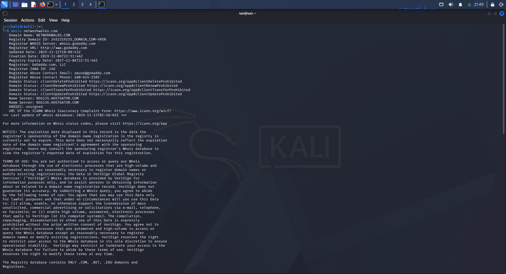

*Figure 1: WHOIS lookup of networkwalks.com (Kali Linux)*

#### 4.1.2 WhatWeb: web technology fingerprint

**Command:**

```bash
whatweb networkwalks.com
```

**Result:** The plain HTTP request received a 307 redirect to megaplusredirection.tedata.net, and opening that page timed out. The output shows a proxy "middlebox", so this redirect appears to come from the network path of my own internet connection and not from the target. The HTTPS request returned 200 OK and identified an Apache web server, WordPress 7.1.4 with WordPress Download Manager 3.3.76, jQuery 3.7.1, Google Tag Manager and HTML5. The page title is "Networkwalks Academy", the IP is 192.232.216.135 and the contact email info@networkwalks.com is visible. The `__wpdm_client` cookie is set with HttpOnly. WhatWeb also listed Bootstrap with the same version number as WordPress, which is probably a false match.

**Why it matters:** Knowing the CMS and plugin versions lets an attacker look up known vulnerabilities for those exact versions. A visible email address is useful for phishing lists.

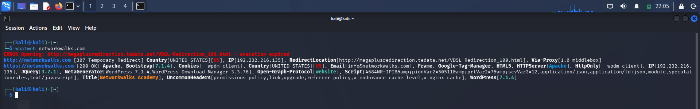

*Figure 2: WhatWeb fingerprint of networkwalks.com*

#### 4.1.3 Nslookup: DNS resolution

**Command:**

```bash
nslookup networkwalks.com
```

**Result:** My DNS server (10.0.0.1) returned a non-authoritative answer: networkwalks.com resolves to 192.232.216.135.

**Why it matters:** This gives the IP address of the target, which is the starting point for the other tools. "Non-authoritative" means the answer came from a resolver and not directly from the domain's own name servers.

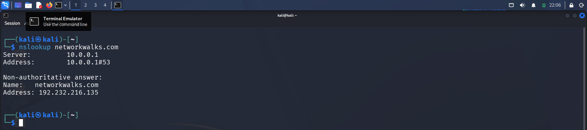

*Figure 3: nslookup of networkwalks.com*

#### 4.1.4 Curl: HTTP response headers

**Command:**

```bash
curl -I https://networkwalks.com
```

**Result:** The server answered HTTP/2 200 with the header `server: Apache`. The headers `x-nginx-cache: WordPress` and `x-endurance-cache-level: 0` show a caching layer in front of WordPress. A `link` header points to the WordPress REST API at `/wp-json/`. The `__wpdm_client` cookie has the Secure and HttpOnly flags. A Referrer-Policy and a Permissions-Policy are present. In this response I did not see Strict-Transport-Security, X-Frame-Options, Content-Security-Policy or X-Content-Type-Options. The server date was Thu, 12 Nov 2026 03:07:20 GMT.

**Why it matters:** The headers confirm the stack found by WhatWeb from a second source. The REST API path is a common starting point for enumerating a WordPress site, and missing security headers weaken protection against clickjacking and downgrade attacks.

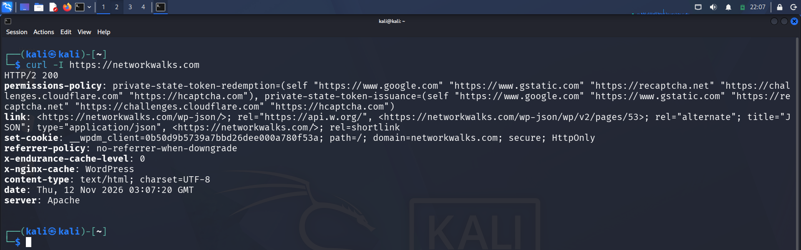

*Figure 4: HTTP response headers from curl -I*

#### 4.1.5 Wafw00f: firewall detection

**Command:**

```bash
wafw00f networkwalks.com
```

**Result:** Wafw00f v2.4.2 sent 2 requests and reported that https://networkwalks.com is behind a ModSecurity (SpiderLabs) Web Application Firewall.

**Why it matters:** An attacker learns to expect filtered or blocked requests and has to adjust their tools. For the site owner it is a good sign that a WAF is in place. Only 2 requests were needed, which fits the light-touch scope.

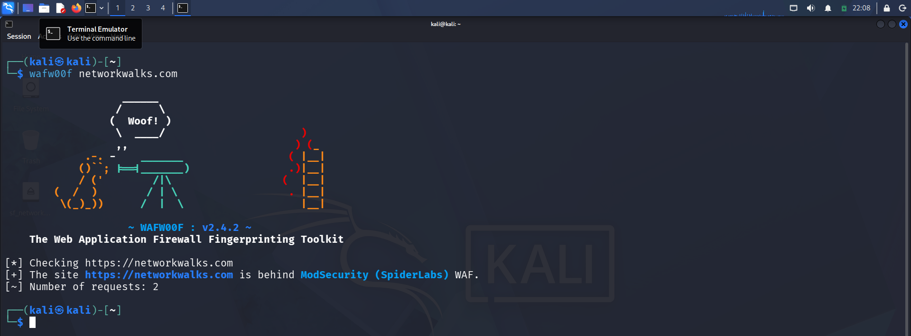

*Figure 5: WAF detection with wafw00f*

#### 4.1.6 DNSRecon: DNS record enumeration

**Command:**

```bash
dnsrecon -d networkwalks.com
```

**Result:** The standard enumeration returned the records below. The tool's "8 Records Found" line counts the SRV records.

- **SOA/NS:** ns6135.hostgator.com (50.87.144.87) and ns6136.hostgator.com (192.232.216.131). Both name servers reported the BIND version 9.16.23-RH.
- **A and MX:** networkwalks.com and mail.networkwalks.com both point to 192.232.216.135.
- **TXT:** an SPF record, `v=spf1 +a +mx +ip4:50.87.144.87 +include:websitewelcome.com ~all`, and a Google site-verification record.
- **SRV:** 8 `_autodiscover._tcp` records pointing to cpanelemaildiscovery.cpanel.net on port 443.
- **DNSSEC:** the query got no answer, which matches the unsigned status seen in WHOIS.

**Why it matters:** The records map the infrastructure: the website and mail share one server on cPanel shared hosting. The BIND version helps an attacker look for known DNS-server issues. The SPF record ends in `~all` (soft fail), so spoofed mail pretending to be the domain may still be accepted or only flagged.

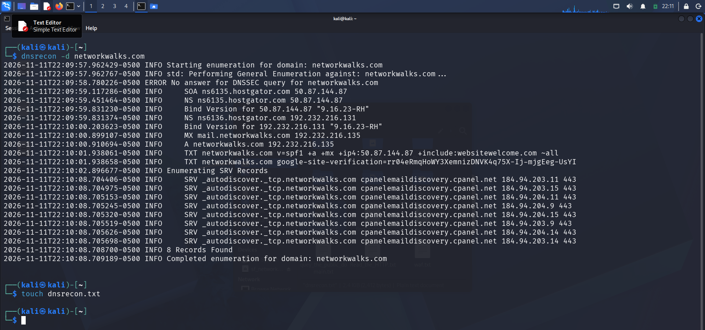

*Figure 6: DNS enumeration with dnsrecon (times shown in Kali local time, UTC-5)*

### 4.2 Network Scanning with Zenmap (W2-PM5)

For the scanning phase I used Zenmap, the graphical interface of Nmap, from my Windows 10 machine. I scanned only my own lab network, as the authorisation allows.

#### 4.2.1 Install Nmap and Zenmap

I downloaded nmap-7.993-setup.exe (36.2 MB) from the Windows section of nmap.org and ran the installer. Zenmap is installed together with Nmap.

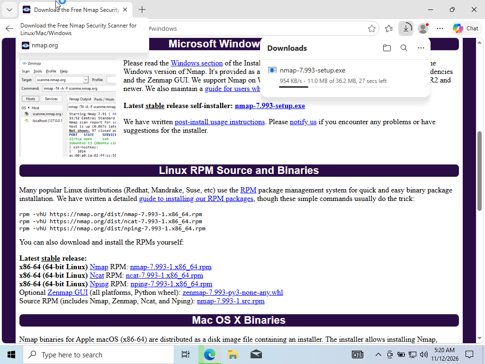

*Figure 7: Downloading the Nmap Windows installer*

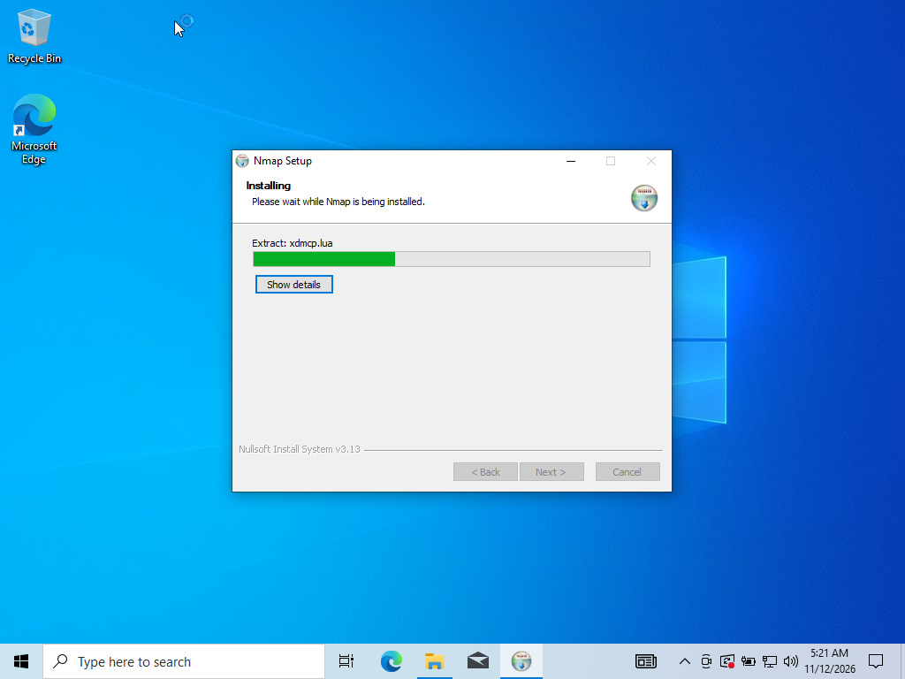

*Figure 8: Nmap setup installing*

#### 4.2.2 Identify the local network

**Command:**

```bat
ipconfig
```

**Result:** The Windows 10 machine has IPv4 address 10.0.0.10, subnet mask 255.255.255.0 and default gateway 10.0.0.1. That puts it in the 10.0.0.0/24 network, which has 256 addresses.

**Why it matters:** Before scanning, an attacker on a network first finds out which range they are in. The /24 mask tells how many addresses need to be checked.

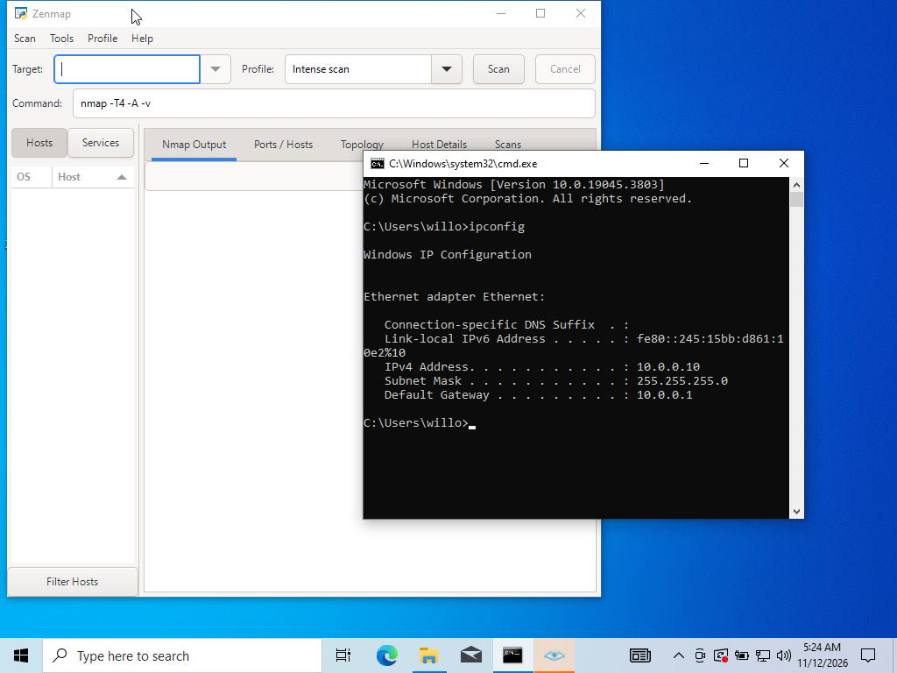

*Figure 9: Zenmap opened and ipconfig output in Command Prompt*

#### 4.2.3 Ping scan of the subnet

**Command:**

```bash
nmap -sn 10.0.0.0/24
```

In Zenmap I set the target to 10.0.0.0/24 and chose the Ping scan profile. The scan started on 2026-11-12 at 05:25 (+0200) with Nmap 7.993.

**Result:** 256 IP addresses were scanned in 5.98 seconds and 3 hosts were up:

| Host | MAC address | Vendor reported by Nmap | Role | Latency |
|---|---|---|---|---|
| 10.0.0.1 | 52:54:00:12:35:00 | QEMU virtual NIC | Default gateway | 0.0050 s |
| 10.0.0.2 | 08:00:27:5A:87:BC | Oracle VirtualBox virtual NIC | Kali Linux VM | 0.018 s |
| 10.0.0.10 | Not shown (this is the scanning machine) | - | Windows 10 VM (scanner) | - |

**Why it matters:** A ping scan lists the live hosts without probing any ports. The MAC vendor names show that the devices are virtual: the two VMs and the VirtualBox gateway. An attacker would use this list as the target list for port scans.

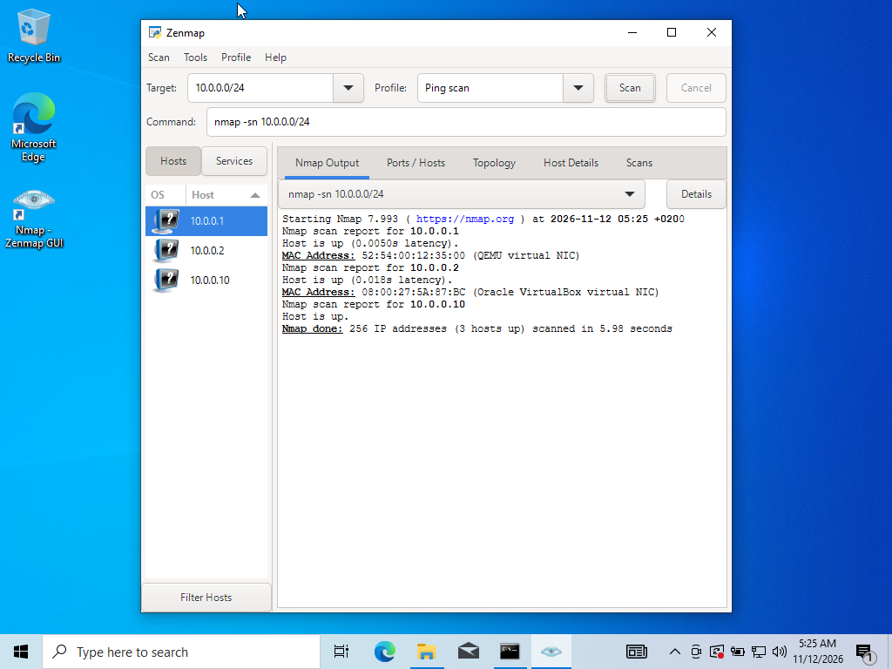

*Figure 10: Zenmap ping scan results for 10.0.0.0/24*

#### 4.2.4 Network topology

The Topology tab draws the scanned host (localhost) in the centre with 10.0.0.1, 10.0.0.2 and 10.0.0.10 around it. I saved the graphic as a PDF with Save Graphic. The legend shows that dashed lines mean there is no traceroute information, which is expected because only a ping scan was run.

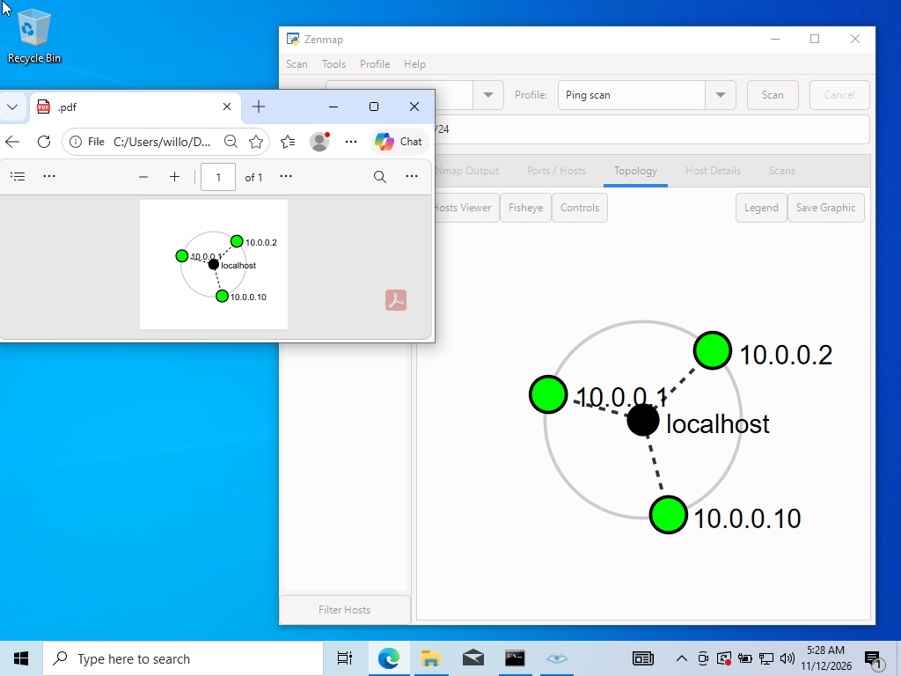

*Figure 11: Topology view with the saved PDF*

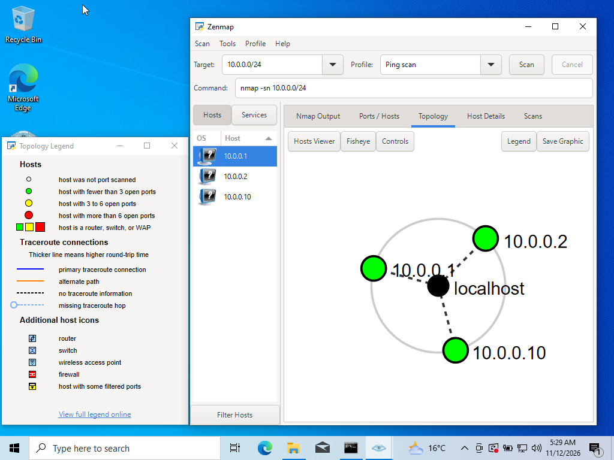

*Figure 12: Topology legend*

## 5. Summary of Findings

All items are informational observations from passive and light checks. Nothing was exploited.

| Observation | Why it matters | Suggested fix |
|---|---|---|
| Domain data is public but protected: contacts hidden by a privacy service, four registrar locks set, DNSSEC unsigned (WHOIS, dnsrecon). | Locks and privacy make hijacking and contact harvesting harder. Unsigned DNSSEC means DNS answers cannot be cryptographically validated. | Keep the locks and privacy on. Consider enabling DNSSEC if the DNS host supports it. |
| Web stack and versions are visible: Apache, WordPress 7.1.4, WordPress Download Manager 3.3.76, jQuery 3.7.1 (whatweb). | An attacker can search for known flaws in those exact versions. | Keep core, plugins and libraries updated; reduce version disclosure where possible. |
| Response headers reveal the caching layer and the REST API (/wp-json/). No HSTS, X-Frame-Options, CSP or X-Content-Type-Options seen in this response (curl -I). | The REST API is a starting point for enumerating a WordPress site. Missing headers weaken browser-side protections such as HTTPS enforcement and clickjacking defence. | Add the standard security headers; restrict REST API endpoints that are not needed. |
| Site sits behind a ModSecurity (SpiderLabs) WAF (wafw00f). | A WAF filters common attack traffic and raises the effort for an attacker. It is a positive control. | Keep rules updated and review its logs. |
| Both name servers disclose the BIND version 9.16.23-RH (dnsrecon). | Version banners help an attacker pick known DNS-server issues. | Hide the version string in the DNS server configuration. |
| SPF record ends with ~all (soft fail) (dnsrecon). | Spoofed mail pretending to be the domain may still be delivered or only flagged, not rejected. | Move to -all once all legitimate senders are listed, and add DMARC. |
| Website and mail share one IP (192.232.216.135) on shared cPanel hosting (nslookup, dnsrecon). | One host holds several services, so a problem on one can affect the others. | Keep the hosting account patched; separate services where practical. |
| Lab network 10.0.0.0/24 has 3 live hosts; MAC vendors show they are virtual machines/network devices (Zenmap). | A ping scan gives an attacker a quick list of targets for port scans, and the vendor shows the environment is virtualised. | Expected for a lab. On a real network, limit who can scan and monitor for sweeps. |

## 6. Conclusion

Phase 1 gave a clear picture of the networkwalks.com public footprint using only public records and a few light requests: the registrar and DNS host, the IP address, the web stack and its versions, the WAF in front of the site and the mail setup. Phase 2 mapped my own lab network and found three live hosts.

No exploitation, brute force, denial of service or testing outside the authorised scope took place. Port and service scanning and vulnerability assessment belong to later phases and are not covered here. The raw tool output files (whois, whatweb, nslookup, curl, wafw00f, dnsrecon) and all screenshots are kept as supporting evidence.
